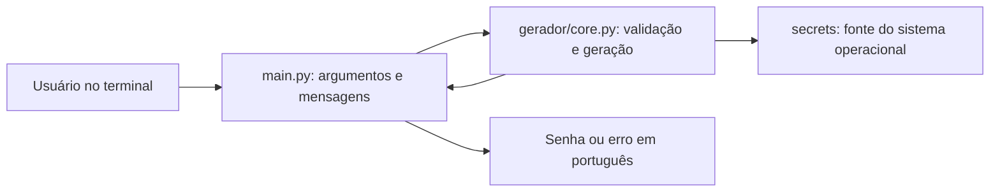

# Gerador de Senhas Seguras

Mini projeto individual de CLI em Python para gerar senhas com tamanho e
categorias de caracteres escolhidos pelo usuário, com apoio de IA generativa
durante o desenvolvimento.

**Autor:** Abimaeltavares  
**Versão:** 1.0.0 · **Licença:** MIT · **Python:** 3.11 ou superior

Projeto desenvolvido para a Especialização em Engenharia de Software:
Automação e Inovação com Inteligência Artificial Generativa da UFG,
trilha Introdução Prática, com orientação do professor Ms. Leon Sólon da Silva.
Informações acadêmicas fornecidas pelo autor.

## Problema e objetivo

A criação manual de senhas pode produzir padrões previsíveis. O objetivo deste
MVP é gerar caracteres usando uma fonte criptograficamente segura, respeitando
as categorias solicitadas e verificando as entradas.

A aplicação funciona localmente, sem API, banco de dados ou conexão com a internet
durante a geração. Não salva senhas em arquivos, logs ou histórico próprio.

## Funcionalidades

- Tamanho padrão de 16 caracteres, com limite de 128.
- Seleção de minúsculas, maiúsculas, números e símbolos.
- Todas as categorias são usadas quando nenhuma é especificada.
- Pelo menos um caractere de cada categoria selecionada.
- Escolha de caracteres com `secrets.choice`.
- Embaralhamento Fisher–Yates com `secrets.randbelow`.
- Erros claros em português para entradas inválidas.
- Ajuda com `--help` e saída de sucesso contendo somente a senha.

## Tecnologias

| Tecnologia | Papel |
|---|---|
| Python 3.11+ | Linguagem e ambiente de execução |
| argparse | Argumentos e ajuda da CLI |
| secrets | Aleatoriedade criptográfica |
| string | Categorias de caracteres ASCII |
| pytest | Testes automatizados, somente no desenvolvimento |
| Git | Histórico com Conventional Commits |

As dependências de teste estão fixadas em `requirements.txt`, incluindo as
transitivas. Não há dependências externas de runtime.

## Arquitetura



```text
main.py                        Interface CLI
gerador/core.py                Geração, validação e embaralhamento
tests/test_core.py             Testes do núcleo
tests/test_cli.py              Testes reais da CLI por subprocesso
docs/arquitetura.md             Decisões de arquitetura
docs/diario-desenvolvimento.md  Registro das etapas e do TDD
docs/postagem-forum.md          Rascunho de submissão
AGENTS.md                      Instruções de escopo e qualidade
Makefile                       Comandos install, test e run
iniciar.cmd                    Facilitador local no Windows
```

## Requisitos

- Python 3.11 ou superior; recomendamos usar uma das versões verificadas
  indicadas na seção de testes.
- Git para clonar após a publicação.
- Internet apenas para baixar Python e instalar as dependências de teste.
- GNU Make é opcional; comandos equivalentes são fornecidos abaixo.

Na cópia local do autor, Python e o ambiente virtual já foram preparados.
Ferramentas baixadas ficam em `.tools` e não são versionadas.

## Executar agora na pasta local preparada

No PowerShell:

```powershell
cd "C:\Programa da pós\gerador-senhas-ufg"
.\.venv\Scripts\python.exe main.py
.\.venv\Scripts\python.exe main.py --tamanho 20
.\.venv\Scripts\python.exe main.py --tamanho 12 --maiusculas --numeros
.\.venv\Scripts\python.exe main.py --help
```

Também pode usar `iniciar.cmd`, sem ativar scripts PowerShell:

```powershell
.\iniciar.cmd --tamanho 20
.\iniciar.cmd --tamanho 12 --maiusculas --numeros
.\iniciar.cmd --help
```

Sem argumentos, o facilitador mostra a ajuda. Para gerar com os padrões,
execute diretamente `main.py` como no primeiro exemplo.

## Instalação em outra máquina Windows

Repositório público: [https://github.com/Abimaeltavares/gerador-senhas-ufg](https://github.com/Abimaeltavares/gerador-senhas-ufg).
[Release v1.0.0](https://github.com/Abimaeltavares/gerador-senhas-ufg/releases/tag/v1.0.0).
O acesso às páginas foi confirmado sem autenticação.

Com Python instalado e disponível pelo launcher `py`:

```powershell
git clone https://github.com/Abimaeltavares/gerador-senhas-ufg.git
cd gerador-senhas-ufg
py -3.12 -m venv .venv
.\.venv\Scripts\python.exe -m pip install -r requirements.txt
.\.venv\Scripts\python.exe -m pytest -q
.\.venv\Scripts\python.exe main.py
```

Se estiver usando Python 3.11, substitua `py -3.12` por `py -3.11`.
Se o launcher não estiver disponível, use `python -m venv .venv`
com uma versão compatível instalada.

A ativação do ambiente virtual é opcional:

```powershell
.\.venv\Scripts\Activate.ps1
python main.py --help
```

Se o PowerShell bloquear `Activate.ps1`, use diretamente
`.\.venv\Scripts\python.exe`, conforme os exemplos anteriores.
Não é necessário alterar a política de execução.

## Argumentos e exemplos

| Argumento | Comportamento |
|---|---|
| `--tamanho N` | Inteiro de 1 a 128; padrão 16 |
| `--minusculas` | Letras a-z |
| `--maiusculas` | Letras A-Z |
| `--numeros` | Dígitos 0-9 |
| `--simbolos` | Símbolos de `string.punctuation` |
| `--help`, `-h` | Ajuda e exemplos |

Em um terminal com o ambiente ativado:

```powershell
python main.py
python main.py --tamanho 20
python main.py --tamanho 12 --maiusculas --numeros
python main.py --tamanho 16 --minusculas --maiusculas --numeros --simbolos
python main.py --help
```

Todos esses exemplos são executados nos testes da CLI. As saídas aleatórias
não são reproduzidas na documentação.

Categorias explícitas restringem o alfabeto: `--maiusculas --numeros`
usa somente letras A-Z e números, com pelo menos um de cada.
Sem categorias, o mínimo é 4 caracteres. Com uma categoria, o mínimo é 1.

Exemplo inválido:

```powershell
.\.venv\Scripts\python.exe main.py --tamanho 3
```

Resultado: erro em português, sem senha, com código de saída 2.
Geração bem-sucedida e ajuda retornam código 0. No PowerShell, consulte
`$LASTEXITCODE` imediatamente após a execução.

## Testes

```powershell
.\.venv\Scripts\python.exe -m pytest -q
```

Com GNU Make e Python disponíveis:

```powershell
make install PYTHON=python
make test
make run
```

A suíte possui **61 testes**: 41 do núcleo e 20 da CLI. Verifica tamanho,
as 16 combinações de seleção, caracteres permitidos, presença das categorias,
limites, erros, variação observada e chamadas às fontes criptográficas.
Os testes da CLI executam processos reais e verificam retorno, stdout e stderr.

O teste de variação é uma observação de amostra, com probabilidade desprezível
de colisão total. Não prova segurança matemática nem exige que duas gerações
sempre sejam diferentes. Os testes com fontes controladas verificam chamadas
a `secrets.choice` e `secrets.randbelow`; não avaliam a entropia do sistema operacional.

O ciclo Red → Green → Refactor do núcleo foi executado e registrado no
[diário](docs/diario-desenvolvimento.md). Os resultados finais e versões
verificadas constam em [VALIDACAO.md](docs/VALIDACAO.md).

O GitHub Actions executou os 61 testes em Windows e Ubuntu, com Python
3.11 e 3.12. As quatro combinações foram aprovadas.
[Execução verificada](https://github.com/Abimaeltavares/gerador-senhas-ufg/actions/runs/38488310328).

## IA generativa no ciclo de vida

A IA, pelo Codex, apoiou a interpretação dos requisitos, arquitetura,
testes, implementação, refatoração, revisão e documentação.

| Etapa | Apoio da IA | Evidência |
|---|---|---|
| Planejamento | Escopo e separação CLI/núcleo | Arquitetura e AGENTS.md |
| Testes | Casos válidos, inválidos e fontes seguras | tests/ e fase Red real |
| Implementação | Validações, geração e CLI | Código e fase Green |
| Refatoração | Extração do embaralhamento | Commit e reexecução dos testes |
| Revisão | Leitura do código e conferência de comandos | Diário e validação |
| Documentação | README, diário e postagem | docs/ |

A participação humana observada foi definir requisitos, escolher o tema,
solicitar planejamento e autorizar a execução. O autor ainda deve compreender
e revisar o código antes de apresentar; não se declara revisão humana concluída.

O pedido foi analisado por elementos do CO-STAR: contexto acadêmico, objetivo
de gerar senhas, estilo simples, tom em português, público do projeto e resposta
esperada com código, testes e documentação. Essa é uma análise do pedido real,
não um novo prompt inventado como se tivesse sido enviado pelo autor.

## Segurança e limitações

- A aleatoriedade vem de `secrets`, apropriado para senhas segundo a
  [documentação oficial do Python](https://docs.python.org/3/library/secrets.html).
- Não se usa `random` comum para caracteres ou embaralhamento.
- A aplicação não persiste senhas. Elas aparecem no terminal; redirecionamentos
  feitos pelo usuário e o histórico visual do terminal ficam fora desse controle.
- A força de uma senha depende do tamanho e do alfabeto escolhido. Aceitar
  uma senha curta para testar limites não garante que ela seja adequada ao uso real.
- A construção garante categorias e mistura as posições, mas não promete
  uniformidade entre todas as senhas possíveis que satisfazem a restrição.
- Símbolos incluem aspas, barras e outros caracteres ASCII; sites podem ter
  regras diferentes. Não há exclusão personalizada de símbolos neste MVP.
- Não há avaliação de senhas existentes, armazenamento, clipboard nem interface web.
- Próximos passos possíveis: exclusão de caracteres ambíguos e escolha de símbolos
  permitidos, somente após uma nova definição de escopo.

## Créditos e licença

Autor: Abimaeltavares. Implementação assistida por Codex.
Licença [MIT](LICENSE).

Referências:
[secrets](https://docs.python.org/3/library/secrets.html),
[argparse](https://docs.python.org/3/library/argparse.html),
[pytest](https://docs.pytest.org/en/stable/),
[Conventional Commits](https://www.conventionalcommits.org/pt-br/v1.0.0/).
