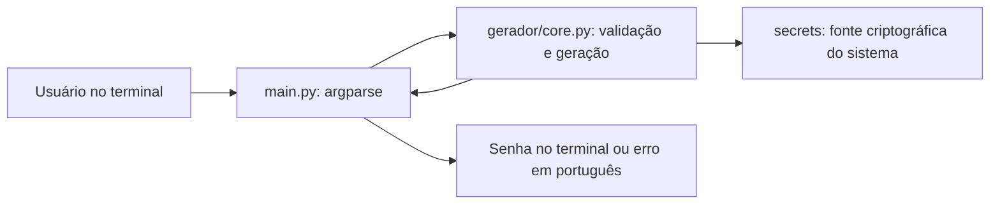

# Arquitetura e decisões de design

## Fluxo da aplicação

## Decisões e justificativas

| Decisão | Justificativa |
|---|---|
| Python 3.11+ | Atende ao ambiente Windows/PowerShell pedido e oferece as bibliotecas necessárias na instalação padrão. |
| CLI com argparse | Faz análise dos argumentos, ajuda e códigos de erro sem exigir interface web ou dependências externas de runtime. |
| secrets | Fornece escolhas adequadas ao uso de segurança; random comum não atende ao requisito do gerador. |
| string | Define alfabetos ASCII conhecidos, fáceis de documentar e verificar nos testes. |
| main.py separado de gerador/core.py | Permite testar a geração sem capturar o terminal e testar a CLI em subprocessos independentes. |
| pytest e Ruff apenas no desenvolvimento | pytest verifica comportamento; Ruff verifica estilo, importações e formatação. A geração não depende deles. |
| Sem banco nem serviços externos | O MVP apenas produz uma senha no terminal; persistência e chamadas de rede ampliariam o escopo e o tratamento de dados. |

## Responsabilidade única e DRY

O princípio de responsabilidade única (SRP, de SOLID) é aplicado pela
separação dos motivos de mudança:

- `main.py` trata argumentos, ajuda, mensagens e códigos de saída.
- `gerar_senha` valida o tamanho e monta os caracteres das categorias.
- `_embaralhar` realiza apenas o Fisher–Yates com índices seguros.

O núcleo não conhece o terminal e não imprime. A CLI reutiliza o núcleo,
sem repetir a regra de geração. Isso evita duplicação (DRY) e permite
verificar o comportamento em camadas separadas.

Não se afirma aplicar todos os princípios SOLID. Um gerador pequeno e
funcional não precisa de hierarquias de classes, interfaces ou injeção de
dependências para justificar sua arquitetura.

## Contrato e algoritmo

`gerar_senha(tamanho=16, *, minusculas=False, maiusculas=False,
numeros=False, simbolos=False) -> str`.

Sem categorias explícitas, são usadas as quatro categorias. O tamanho deve
ser inteiro de 1 a 128 e comportar pelo menos um caractere por categoria.
Entradas inválidas levantam `ValueError`; a CLI apresenta a mensagem em
português e encerra com código 2. O código 0 indica sucesso ou ajuda.

Escolhe-se um caractere de cada categoria com `secrets.choice`, completa-se
a senha com o alfabeto permitido e embaralha-se com Fisher–Yates usando
`secrets.randbelow`. Não há arquivo, log, banco ou chamada de rede no núcleo.

Essa construção garante categorias e embaralhamento seguro, mas não promete
distribuição uniforme entre todas as senhas válidas. Não foram calculadas
estimativas de entropia nem deduzida segurança a partir de uma amostra.

## Verificação

Os testes do núcleo cobrem regras e chamadas às fontes criptográficas.
Os testes da CLI executam subprocessos e verificam retorno, stdout e stderr.
`make lint` executa Ruff e confere a formatação; `make test` executa pytest.
