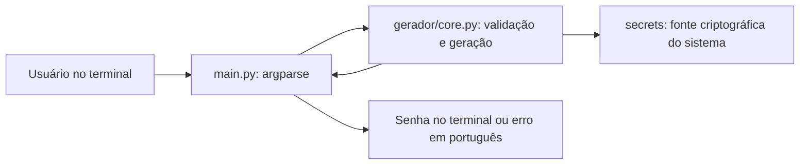

# Arquitetura mínima

A CLI recebe opções, chama o núcleo e imprime a senha ou uma mensagem de erro.

O núcleo não conhece argumentos de terminal nem imprime valores. A CLI não
duplica a lógica de geração. Não há banco, API, rede ou persistência.
pytest é usado somente no desenvolvimento.

Contrato planejado: gerar_senha(tamanho=16, minusculas=False, maiusculas=False,
numeros=False, simbolos=False) -> str. Sem opções, todas as categorias são usadas.
Tamanho permitido: 1 a 128, respeitando o número de categorias selecionadas.

Escolhe-se um caractere de cada categoria, completa-se a senha com o alfabeto
permitido e embaralha-se com Fisher–Yates usando secrets.randbelow.
Essa construção garante presença das categorias, mas não promete distribuição
uniforme entre todas as senhas que satisfazem a restrição. Não serão divulgadas
estimativas de entropia ou garantias de segurança baseadas em amostras.

A estrutura solicitada é mantida, com Makefile e integração contínua para
reproduzir as verificações. Não se adiciona biblioteca de runtime.
